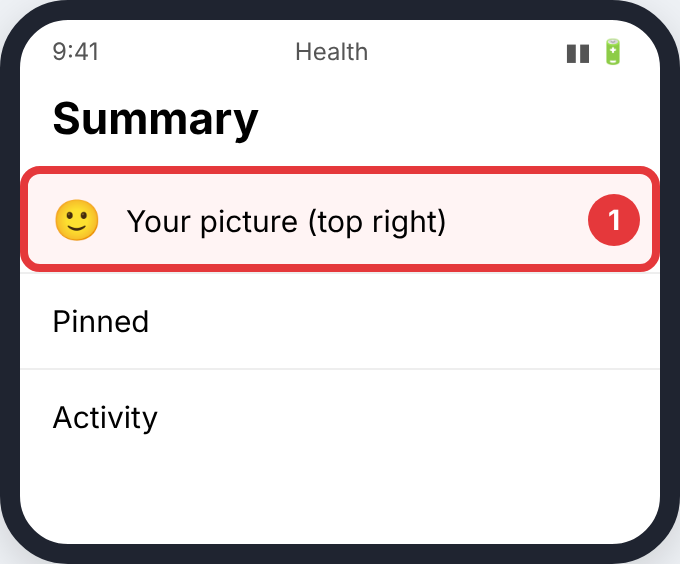
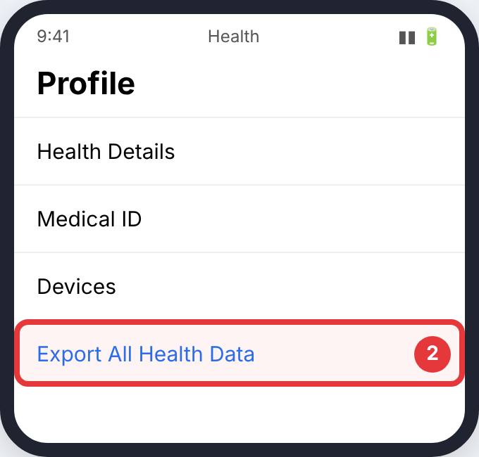
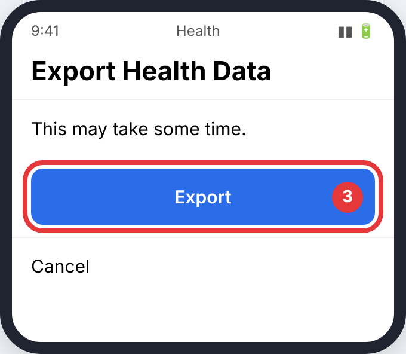
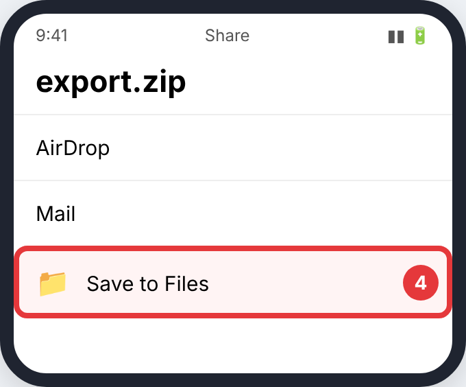

# Apple Health

Only workouts recorded with GPS (outdoor walks, runs, rides) have routes.

> The pictures are simple drawings. The red circle and number show what to tap in each step. Menu names can differ slightly between app versions.

## iPhone

### Step 1: your **picture** (top right)

- **Where:** The **Health** app
- **Tap:** your **picture** (top right)
- **You'll see:** your profile.

### Step 2: **Export All Health Data**

- **Where:** Profile (scroll to the bottom)
- **Tap:** **Export All Health Data**
- **You'll see:** a message that it may take a while.

### Step 3: **Export**, then wait

- **Where:** The export message
- **Tap:** **Export**, then wait
- **You'll see:** a share sheet for *export.zip*.

### Step 4: **Save to Files**

- **Where:** Share sheet
- **Tap:** **Save to Files**
- **You'll see:** *export.zip* in the Files app.

## Good to know

- The full export can take several minutes and can be very large.

## Upload it

Upload `export.zip`; only the routes are read. Too big? Tap the zip in Files to unzip it, then upload the `.gpx` files in `apple_health_export/workout-routes`. How: [Uploading to CrossPaths](Upload.md).

## Official guides (with their own screenshots)

- [iGeeksBlog: export Health data](https://demo.igeeksblog.com/how-to-import-and-export-health-app-data-on-iphone/?pdf=578589)
- [Health Auto Export (routes only, App Store)](https://apps.apple.com/app/id1115567069)
