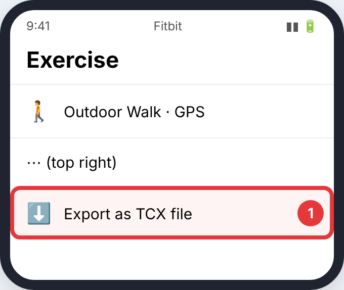
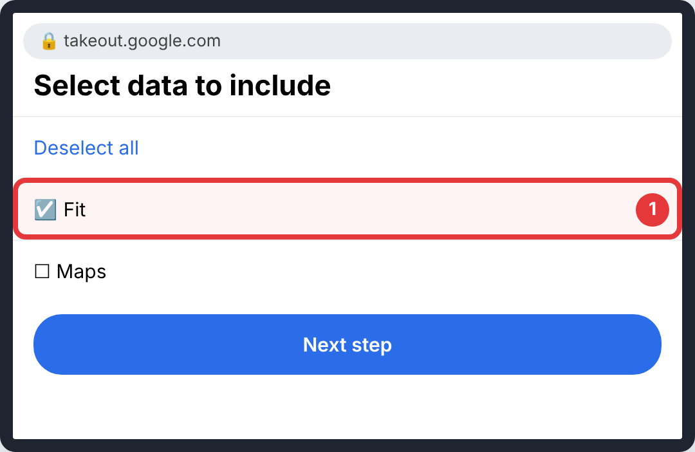
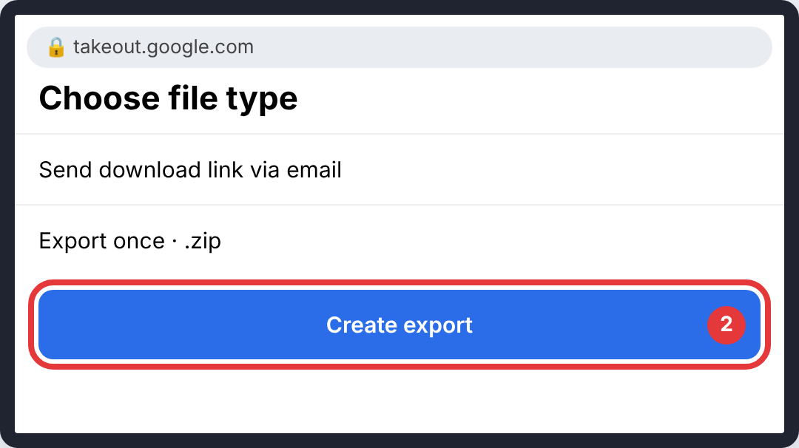

# Fitbit and Google Fit

Health Connect can't export routes. Export from the app that recorded the workout instead.

> The pictures are simple drawings. The red circle and number show what to tap in each step. Menu names can differ slightly between app versions.

## Fitbit (one exercise at a time)

### Step 1: **⋯** → **Export as TCX file**

- **Where:** A GPS exercise in the Fitbit app
- **Tap:** **⋯** → **Export as TCX file**
- **You'll see:** a `.tcx` file to save.

## Google Fit

### Step 1: **Deselect all**, tick **Fit**, then **Next step**

- **Where:** takeout.google.com
- **Tap:** **Deselect all**, tick **Fit**, then **Next step**
- **You'll see:** delivery options.

### Step 2: keep *Export once* and *.zip*, then **Create export**

- **Where:** Delivery options
- **Tap:** keep *Export once* and *.zip*, then **Create export**
- **You'll see:** a message that Google will email you a link.

## Upload it

Upload the `.tcx` or the Takeout `.zip`. How: [Uploading to CrossPaths](Upload.md).

## Official guides (with their own screenshots)

- [Google Takeout](https://takeout.google.com)
