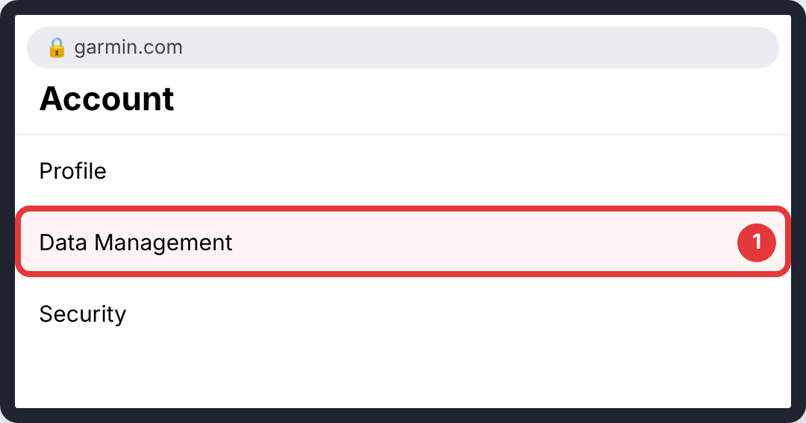
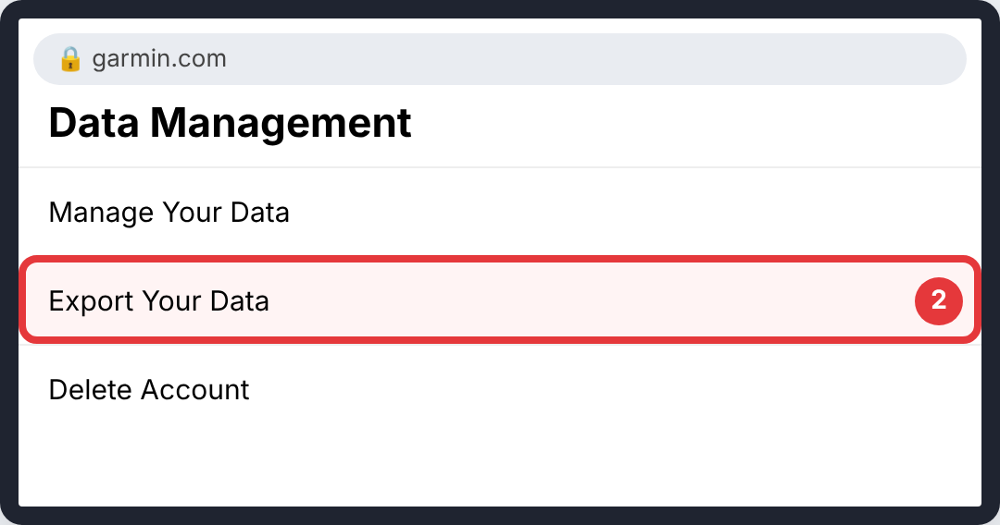
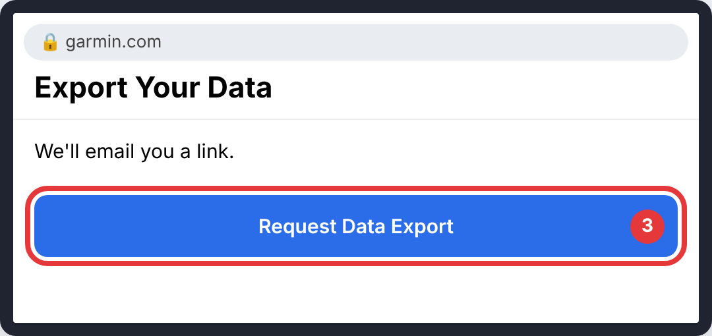
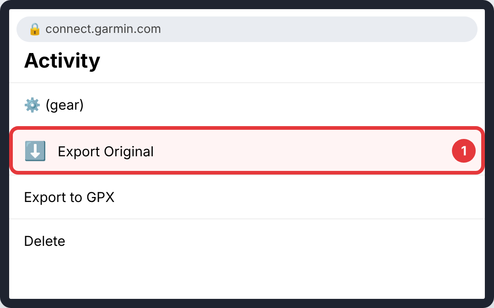

# Garmin

Do this on the Garmin website.

> The pictures are simple drawings. The red circle and number show what to tap in each step. Menu names can differ slightly between app versions.

## Everything

### Step 1: **Data Management**

- **Where:** Your Garmin account page (account settings)
- **Tap:** **Data Management**
- **You'll see:** data options.

### Step 2: **Export Your Data**

- **Where:** Data Management
- **Tap:** **Export Your Data**
- **You'll see:** an export request page.

### Step 3: **Request Data Export**

- **Where:** Export Your Data
- **Tap:** **Request Data Export**
- **You'll see:** a message that Garmin will email you.

## One activity

### Step 1: ⚙️ → **Export Original** (or **Export to GPX**)

- **Where:** The activity on connect.garmin.com
- **Tap:** ⚙️ → **Export Original** (or **Export to GPX**)
- **You'll see:** a file downloaded at once.

## Good to know

- The full export email can take 1–2 days.

## Upload it

Upload the `.zip`, `.fit` or `.gpx` as it is. How: [Uploading to CrossPaths](Upload.md).

## Official guides (with their own screenshots)

- [gneta.app: export Garmin data step by step](https://www.gneta.app/blog/export-garmin-data-guide)
- [Garmin forum: export all data](https://forums.garmin.com/apps-software/mobile-apps-web/f/garmin-connect-web/407936/export-data)
