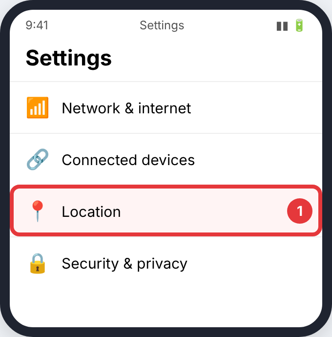
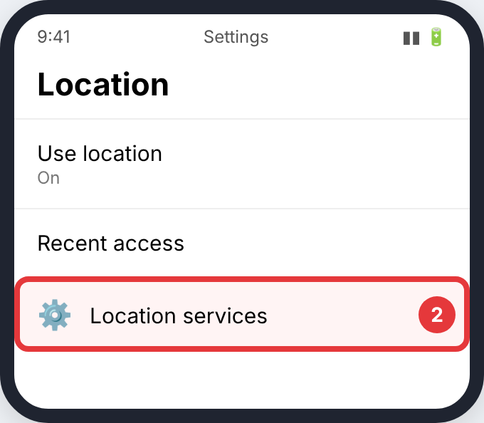
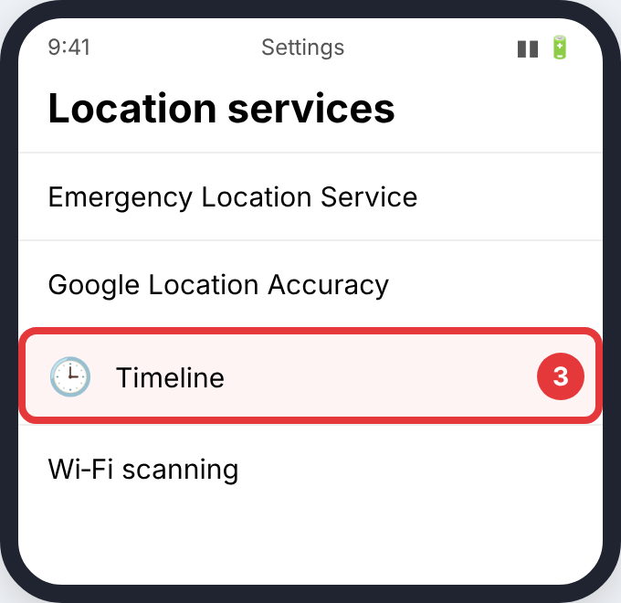
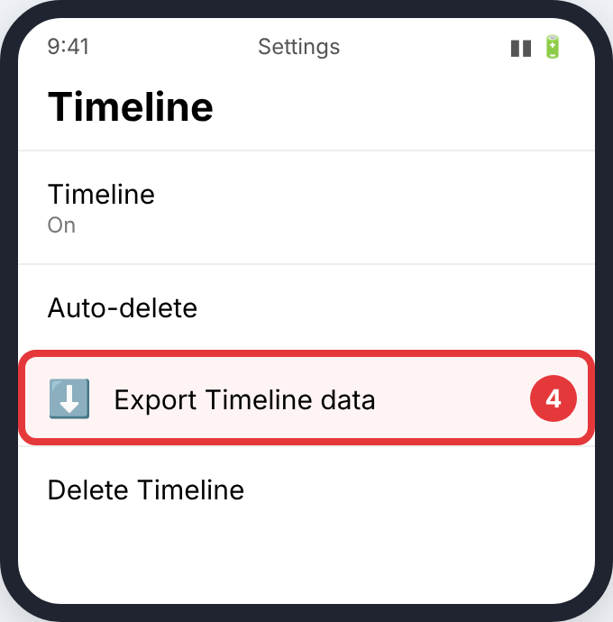
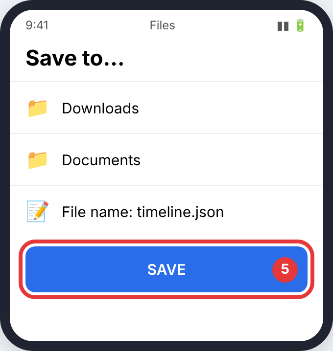
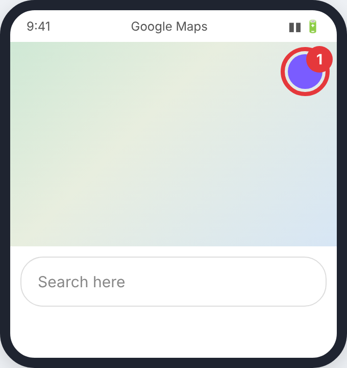
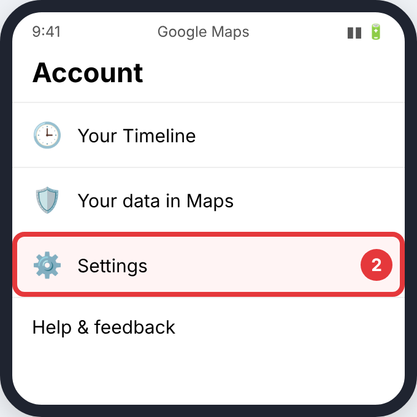
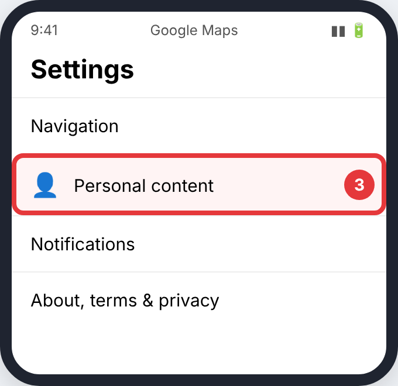
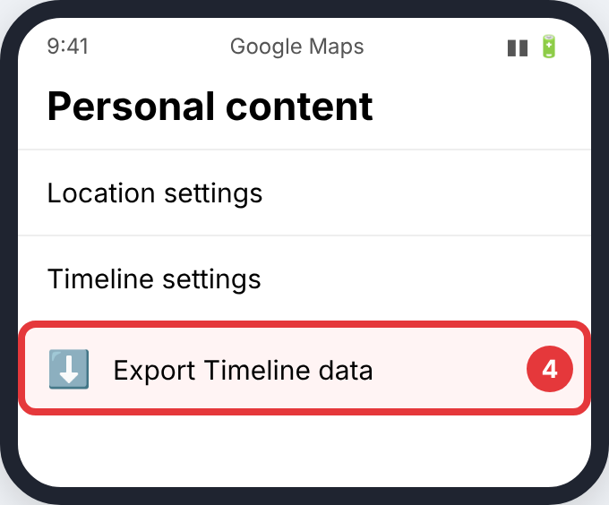
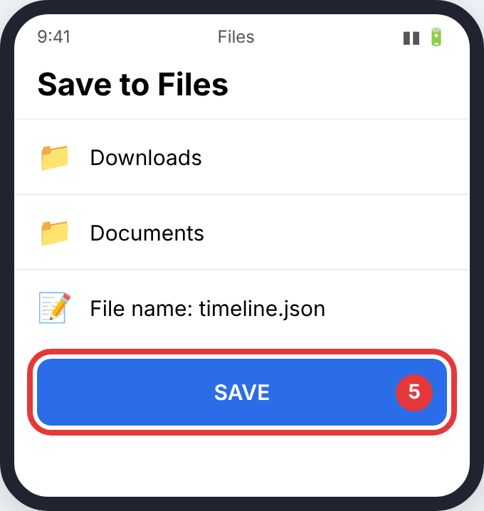

# Google Maps Timeline

Timeline now lives on your phone, so you export it from the phone (not Takeout).

> Pictures are simplified drawings of each screen with the button to press circled in red. Menu names change a little between app versions.

## Android

**Step 1.** Open the phone's **Settings** and tap **Location**.

**Step 2.** Tap **Location services**.

**Step 3.** Tap **Timeline**.

**Step 4.** Tap **Export Timeline data**.

**Step 5.** Pick a folder (e.g. Downloads) and tap **Save**. You get a `.json` file.

## iPhone

**Step 1.** Open **Google Maps** and tap your **profile picture** (top right).

**Step 2.** Tap **Settings**.

**Step 3.** Tap **Personal content**.

**Step 4.** Tap **Export Timeline data**.

**Step 5.** Choose **Save to Files** and tap **Save** (same save screen as Android).

## Then upload it

Upload the `.json` file. Older Google Takeout downloads also work: `Records.json`, the *Semantic Location History* folder, or the whole Takeout `.zip`.

See [Uploading to CrossPaths](Upload.md).
