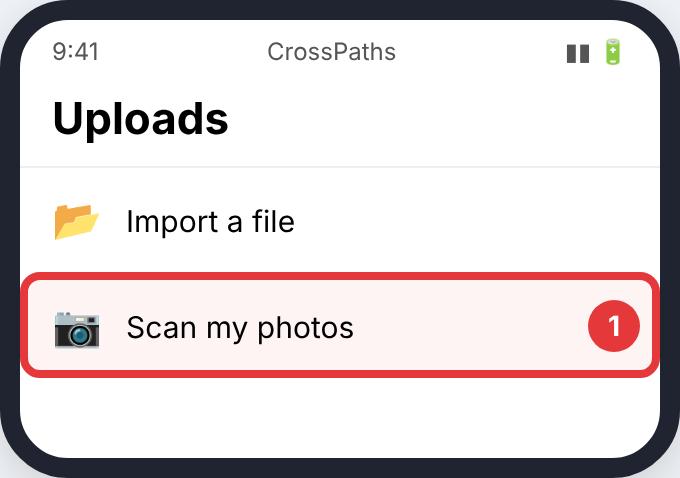
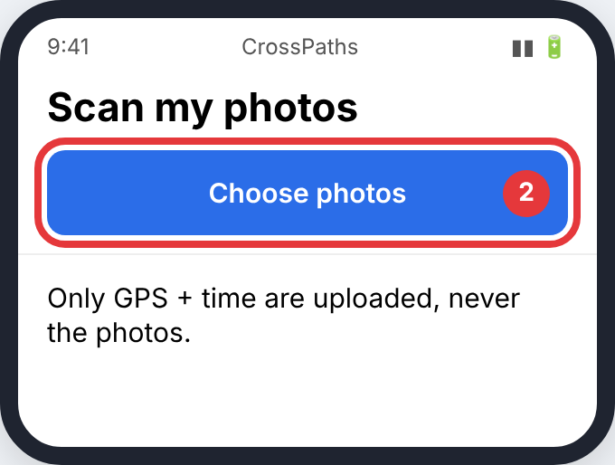

# Photos

No export needed: CrossPaths reads the GPS position and time saved in your photos, on your device. Only those points are uploaded, never the photos.

> Pictures are simplified drawings of each screen with the button to press circled in red. Menu names change a little between app versions.

## In CrossPaths

**Step 1.** On **Uploads**, tap **Scan my photos**.

**Step 2.** Tap **Choose photos** and select as many as you like (at least 20 need a location).

## Then upload it

Screenshots and photos sent through chat apps usually have no location and are skipped.

See [Uploading to CrossPaths](Upload.md).
