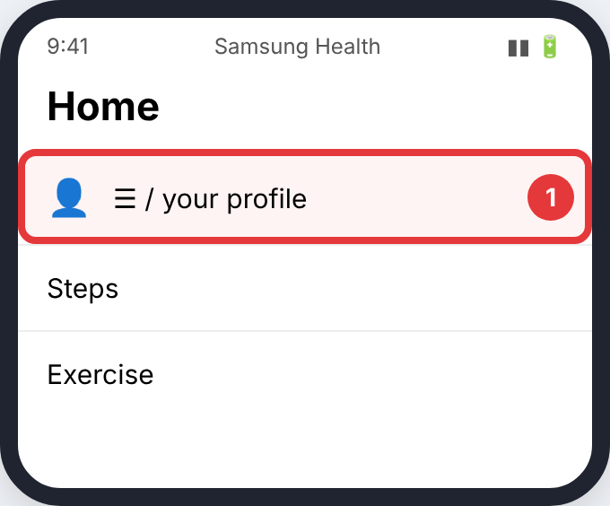
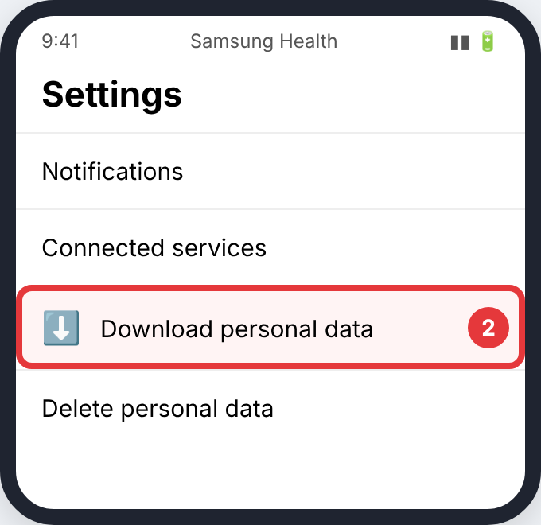
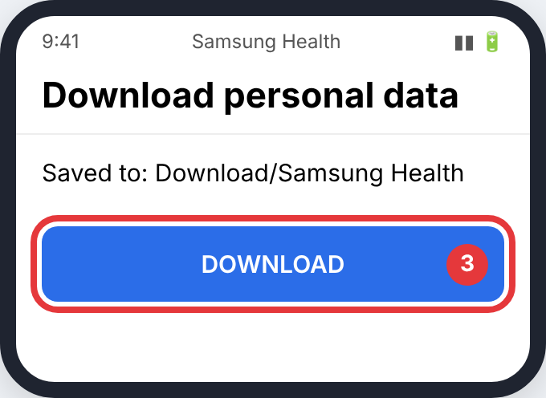
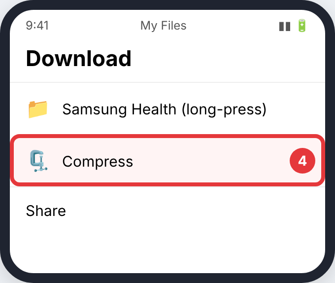

# Samsung Health

> The pictures are simple drawings. The red circle and number show what to tap in each step. Menu names can differ slightly between app versions.

## Android

### Step 1: **☰** or your profile, then **Settings**

- **Where:** The **Samsung Health** app
- **Tap:** **☰** or your profile, then **Settings**
- **You'll see:** the Samsung Health settings.

### Step 2: **Download personal data**

- **Where:** Settings
- **Tap:** **Download personal data**
- **You'll see:** a download page.

### Step 3: **Download** (you may have to sign in)

- **Where:** Download personal data
- **Tap:** **Download** (you may have to sign in)
- **You'll see:** a message that the files are in *Download/Samsung Health*.

### Step 4: long-press **Samsung Health** → **Compress**

- **Where:** **My Files** → Internal storage → Download
- **Tap:** long-press **Samsung Health** → **Compress**
- **You'll see:** a new `.zip` file.

## Upload it

Upload the `.zip`. Only the routes in `location_data.json` are read. How: [Uploading to CrossPaths](Upload.md).

## Official guides (with their own screenshots)

- [Samsung: download your Samsung Health data](https://www.samsung.com/us/support/answer/ANS00085104/)
