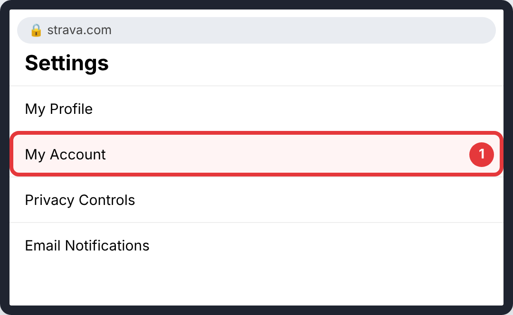
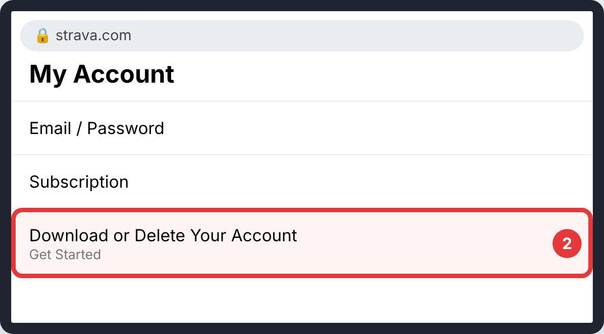
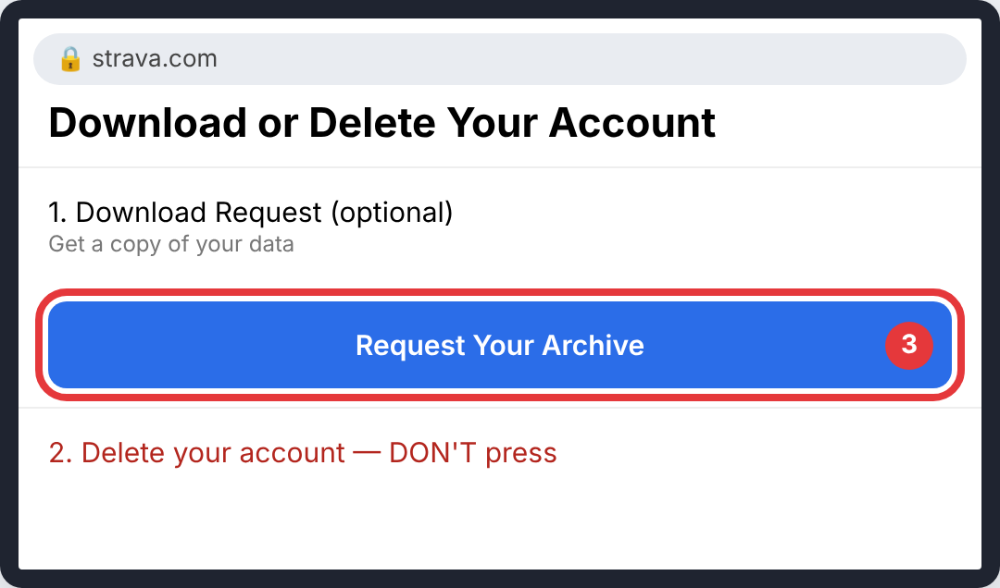
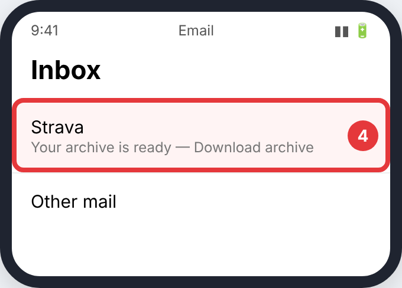
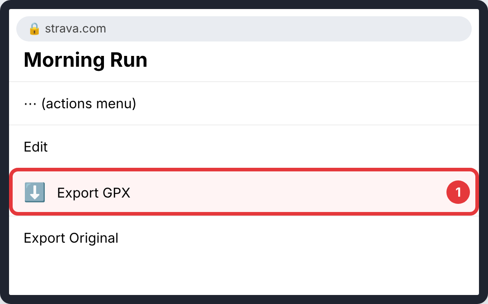

# Strava

Do this on the **strava.com website** (phone browser or computer). The app can't do it.

> The pictures are simple drawings. The red circle and number show what to tap in each step. Menu names can differ slightly between app versions.

## Everything (archive)

### Step 1: **My Account** (left menu)

- **Where:** strava.com, logged in → profile picture menu → **Settings**
- **Tap:** **My Account** (left menu)
- **You'll see:** your account page.

### Step 2: **Get Started** under *Download or Delete Your Account*

- **Where:** My Account
- **Tap:** **Get Started** under *Download or Delete Your Account*
- **You'll see:** a page with *Download Request* and *Delete* sections.

### Step 3: **Request Your Archive**. Don't touch the delete section

- **Where:** Download or Delete Your Account
- **Tap:** **Request Your Archive**. Don't touch the delete section
- **You'll see:** a message saying an email is on its way.

### Step 4: **Download archive** in Strava's email

- **Where:** Your email (usually within a few hours)
- **Tap:** **Download archive** in Strava's email
- **You'll see:** a `.zip` file in your downloads.

## One activity

### Step 1: **⋯** → **Export GPX**

- **Where:** The activity's page on strava.com
- **Tap:** **⋯** → **Export GPX**
- **You'll see:** a `.gpx` file downloaded at once.

## Good to know

- The download link expires, so download it soon after the email arrives.
- Photos and segments aren't needed and some aren't included. That's fine.

## Upload it

Upload the `.zip` as it is. If it's too big, unzip it and upload the files in the `activities` folder. How: [Uploading to CrossPaths](Upload.md).

## Official guides (with their own screenshots)

- [Strava: Exporting your data](https://support.strava.com/hc/en-us/articles/216918437-Exporting-your-Activity)
- [takeoutday.org: Strava export guide](https://takeoutday.org/guides/how-to-export-strava-data)
