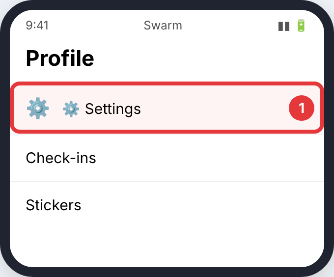
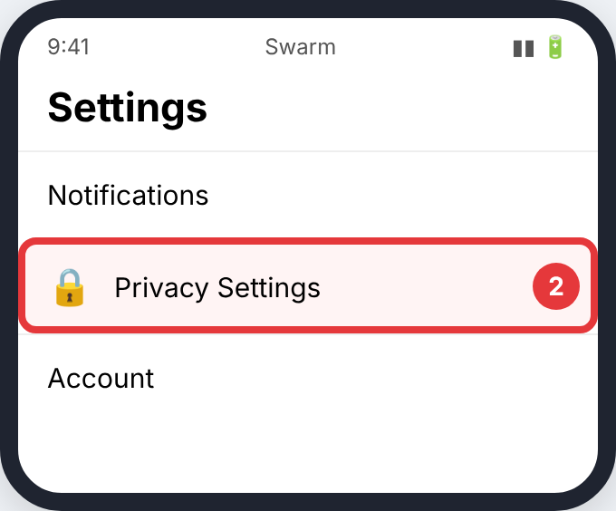
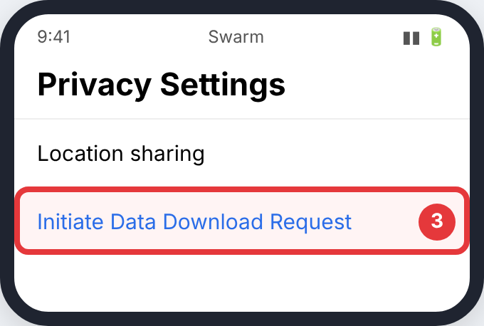

# Swarm (Foursquare)

Each check-in counts as 30 minutes at that place, so matches are rougher than with GPS tracks.

> The pictures are simple drawings. The red circle and number show what to tap in each step. Menu names can differ slightly between app versions.

## Phone

### Step 1: **⚙️ Settings**

- **Where:** Your profile in the **Swarm** app
- **Tap:** **⚙️ Settings**
- **You'll see:** the settings list.

### Step 2: **Privacy Settings**

- **Where:** Settings
- **Tap:** **Privacy Settings**
- **You'll see:** privacy options.

### Step 3: **Initiate Data Download Request**

- **Where:** Privacy Settings
- **Tap:** **Initiate Data Download Request**
- **You'll see:** a confirmation. Foursquare emails you a `.zip` link.

## Upload it

Upload the `.zip` (or the `checkins*.json` files from it). How: [Uploading to CrossPaths](Upload.md).

## Official guides (with their own screenshots)

- [Foursquare support](https://support.foursquare.com)
