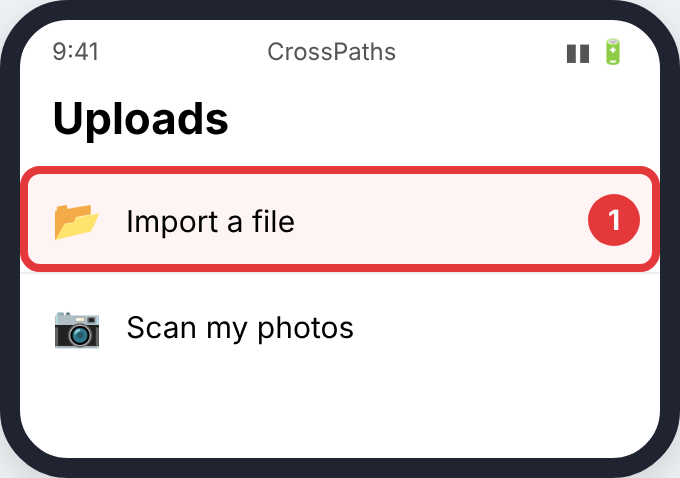
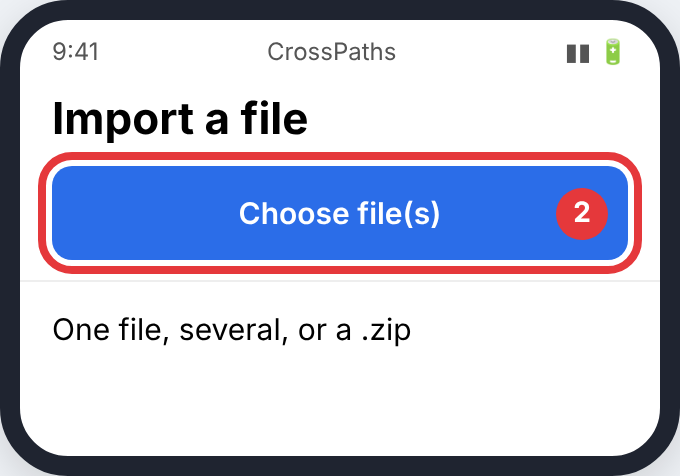

# Uploading to CrossPaths

**Step 1.** On the **Uploads** tab, tap **Import a file**.

**Step 2.** Tap **Choose file(s)** and pick your export. You can pick one file, several at once, or a `.zip`.

Your upload is encrypted and deleted after the time set in your settings.
